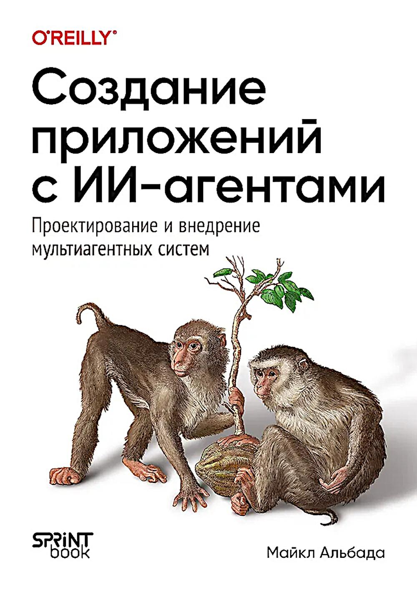

# [Книга][Альбада Майкл] Создание приложений с ИИ-агентами. Проектирование и внедрение мультиагентных систем [RUS, 2026]



[Book][Michael Albada] Building Applications with AI Agents [ENG, 2025]

**Оригинальный код книги:**  
https://github.com/michaelalbada/BuildingApplicationsWithAIAgents

---
:triangular_flag_on_post: Код проектов книги обновляется! :triangular_flag_on_post:  
:warning: **Пока книга кажется скучной, устаревшей и неинтересной!**:warning:   
:warning: Автор не смог нормально код к книге выложить! :warning:

---

Генеративный ИИ произвел революцию в том, как организации решают проблемы, ускорив переход от концепции к прототипу и готовому решению. По мере роста возможностей моделей наблюдается появление нового паттерна проектирования - ИИ-агентов. Сочетание инструментов, знаний, памяти и механизмов обучения с продвинутыми фундаментальными моделями позволяет выстраивать последовательности из нескольких инференсов моделей для решения неоднозначных и сложных задач. Агенты - от помощников разработчика до исследовательских и аналитических агентов - уже ускоряют работу команд и целых организаций. Хотя эти агенты повышают эффективность, они часто требуют тщательного планирования и многочисленных правок, а их развертывание остается проблемой во многих организациях, особенно при стремительном развитии технологий и исследований. Автор Майкл Альбада предлагает практический и основанный на исследованиях подход к проектированию и внедрению одно- и мультиагентных систем. Он упрощает сложности и вооружает инструментами для эффективного перехода от концепций к решению.

---

### Краткое содержание

<ul>
  <li>:white_check_mark: :book: 01. Знакомство с агентами</li>
  <li>:white_check_mark: :book: 02. Проектирование агентных систем</li>
  <li>:white_check_mark: :book: 03. UX-дизайн для агентных систем</li>
  <li>:white_check_mark: :hammer: 04. Инструменты</li>
  <li>:white_check_mark: :hammer: 05. Оркестрация</li>
  <li>:white_check_mark: :hammer: 06. Знания и память</li>
  <li>:white_check_mark: :hammer: 07. Обучение в агентных системах</li>
  <li>:white_check_mark: :hammer: 08. От одного агента ко многим</li>
  <li>09. Проверки и измерения</li>
  <li>10. Мониторинг на стадии эксплуатации</li>
  <li>11. Циклы улучшения</li>
  <li>12. Защита агентных систем</li>
  <li>13. Взаимодействия «человек — агент»</li>
</ul>

---

## Overview

This repository provides a **unified, multi-framework platform** for designing, implementing, and evaluating AI-powered agents. By separating **scenario definitions** from **framework-specific code**, we enable:

- A **single spec** for each scenario (under `src/common/scenarios/`).
- **Parallel implementations** in LangGraph, LangChain, Autogen (and more).
- A **shared evaluation harness** to compare outputs across frameworks.
- **Built-in observability** (Loki logging & OpenTelemetry/Tempo).
- **Unit tests** for core utilities and telemetry setup.

Whether you’re building an e-commerce support bot, an IT support desk assistant, a voice agent, or anything in between, this codebase helps you scale from prototype to production coverage—while maintaining consistency and reusability.

---

## Features

- **Framework-Agnostic Scenario Specs**
  Each scenario under `src/common/scenarios/<scenario_name>/` contains:

  - `spec.md`: A plain-English description of the user journey and success criteria.
  - `data/`: Sample input/output JSON for quick tests or demos.
  - `evaluation/`: A shared `run_eval.py` harness plus a “gold” evaluation set (JSON or CSV).

- **Multi-Framework Implementations**
  Implement each scenario in parallel under:

  - `src/frameworks/langgraph/`
  - `src/frameworks/autogen/`
    _(Easily add more frameworks by following the same folder patterns.)_

- **Built-In Observability**

  - **Loki Logger**:
    `src/common/observability/loki_logger.py` posts structured logs to a local Loki endpoint.
  - **OpenTelemetry / Tempo**:
    `src/common/observability/instrument_tempo.py` sets up an OTLP exporter and instruments spans (parent & child) to Tempo.

- **Unit Tests for Core Utilities & Telemetry**

  - Tests for evaluation utilities:
    `tests/evaluation/test_ai_judge.py` & `test_memory_evaluation.py`
  - Tests for observability code (monkeypatching exporters):
    `tests/observability/test_loki_logger.py` & `test_instrument_tempo.py`

---

## Installation

1. **Clone the Repo**

```bash
$ git clone https://github.com/webmakaka/Building-Applications-With-AI-Agents
$ cd Building-Applications-With-AI-Agents/app
```

2. **Create a Virtual Environment**

```bash
$ pip install uv
$ uv venv --python=python3.12
$ source .venv/bin/activate
$ uv pip install -r requirements.txt
```

---

## Usage

<br/>

### 1. Running a Scenario Evaluation

:warning: Нужные токены! :warning:  
:warning: Дофига всего качается! Гига на 2-3 :warning:  

Each scenario includes a shared evaluator script:

```bash
$ pwd
Building-Applications-With-AI-Agents/app

$ uv pip install bert_score sentence_transformers traceloop-sdk

$ export OPENAI_API_KEY="ваш_ключ_openai"
$ export TRACELOOP_API_KEY="ваш_ключ_traceloop"

// [FAIL!] Нет у меня никаких ключей
$ python -m src.common.evaluation.batch_evaluation \
  --dataset src/common/evaluation/scenarios/ecommerce_customer_support_evaluation_set.jsonl \
  --graph_py src/frameworks/langgraph_agents/ecommerce_customer_support/customer_support_agent.py
```

<br/>

### 2. Launching a Single Framework Agent

If you want to manually run the LangGraph version of the e-commerce agent:

:warning: [FAIL!] ХЗ где искать implementation! :warning:  

```bash
$ python - << 'PYCODE'
from src.frameworks.langgraph.scenarios.ecommerce_customer_support.implementation import run_ecommerce_support

payload = {
  "order": {"order_id": "A12345", "status": "Delivered", "total": 19.99},
  "messages": [{"type": "human", "content": "My mug arrived broken. Refund?"}]
}

response = run_ecommerce_support(payload)
print(response)
PYCODE
```

Replace `run_ecommerce_support` and the payload shape for other scenarios or frameworks accordingly.

### 3. Observability

- **Loki Logging**
  Any call to `log_to_loki(label, message)` in your code sends a JSON payload to:

```
http://localhost:3100/loki/api/v1/push
```

  Point Grafana/Loki at that endpoint to view logs in real time.

- **OpenTelemetry / Tempo**

```python
from common.observability.instrument_tempo import do_work
do_work()  # Emits a parent span and three child spans to the OTLP endpoint (localhost:3200)
```

  To instrument your own functions, import `tracer = common.observability.instrument_tempo.tracer` and wrap code in `with tracer.start_as_current_span("span-name"):` blocks.

---

<br/>

## Структура каталогов

Вот краткий обзор того, как все устроено. 

```
agents/
├── .gitignore
├── README.md
├── environment.yml
├── package.json
├── requirements.txt
├── conftest.py                 # Ensures src/ is on PYTHONPATH for pytest
│
├── resources/                  # Static assets (e.g., book cover)
│   └── book_cover.jpeg
│
├── src/
│   ├── common/                 # Framework-agnostic modules
│   │   ├── evaluation/         # AIJudge, memory_evaluation, metrics
│   │   │   ├── ai_judge.py
│   │   │   ├── batch_evaluation.py
│   │   │   ├── memory_evaluation.py
│   │   │   └── metrics.py
│   │   │
│   │   ├── observability/      # Loki + OpenTelemetry helpers
│   │   │   ├── loki_logger.py
│   │   │   └── instrument_tempo.py
│   │   │
│   │   └── scenarios/          # Scenario specs, data, evaluation harnesses
│   │       ├── ecommerce_customer_support/
│   │       │   ├── spec.md
│   │       │   ├── data/
│   │       │   │   ├── sample_input.json
│   │       │   │   └── sample_expected.json
│   │       │   └── evaluation/
│   │       │       ├── run_eval.py
│   │       │       └── ecommerce_customer_support_evaluation_set.json
│   │       │
│   │       └── flight_booking/
│   │           ├── spec.md
│   │           ├── data/
│   │           │   ├── sample_request.json
│   │           │   └── sample_expected.json
│   │           └── evaluation/
│   │               ├── run_eval.py
│   │               └── flight_booking_full_eval.json
│   │
│   └── frameworks/             # One folder per agent framework
│       ├── autogen/
│       │   └── scenarios/
│       │       └── ecommerce_customer_support/
│       │           └── implementation.py
│       │
│       ├── langchain/
│       │   └── scenarios/
│       │       └── ecommerce_customer_support/
│       │           └── implementation.py
│       │
│       └── langgraph/
│           └── scenarios/
│               └── ecommerce_customer_support/
│                   └── implementation.py
│
└── tests/                      # Unit tests (pytest)
    ├── evaluation/
    │   ├── test_ai_judge.py
    │   └── test_memory_evaluation.py
    │
    └── observability/
        ├── test_loki_logger.py
        └── test_instrument_tempo.py
```

---

## Examples

### 1. Running a LangChain Agent (Ecommerce Support)

```bash
# From repo root:
$ cd app

# Example usage:
$ python - << 'PYCODE'
from src.frameworks.langchain.scenarios.ecommerce_customer_support.implementation import run_ecommerce_support

payload = {
  "order": {"order_id": "A12345", "status": "Delivered", "total": 19.99},
  "messages": [{"type": "human", "content": "My mug arrived broken. Refund?"}]
}

response = run_ecommerce_support(payload)
print(response)
PYCODE
```

### 2. Running a LangGraph Agent (Ecommerce Support)

```bash
# From repo root:
$ cd app

# Example usage:
$ python - << 'PYCODE'
from frameworks.langgraph.scenarios/ecommerce_customer_support.implementation import run_ecommerce_support

payload = {
  "order": {"order_id": "A12345", "status": "Delivered", "total": 19.99},
  "messages": [{"type": "human", "content": "My mug arrived broken. Refund?"}]
}

response = run_ecommerce_support(payload)
print(response)
PYCODE
```

---

## Testing

We use **pytest** for all unit tests:

- **Evaluation utilities tests**:

  - `tests/evaluation/test_ai_judge.py`
  - `tests/evaluation/test_memory_evaluation.py`

- **Observability tests**:

  - `tests/observability/test_loki_logger.py`
  - `tests/observability/test_instrument_tempo.py`

To run the full test suite:

```bash
$ cd /Users/your-user/dev/agents
$ pytest -q
```

All tests should pass without errors.
